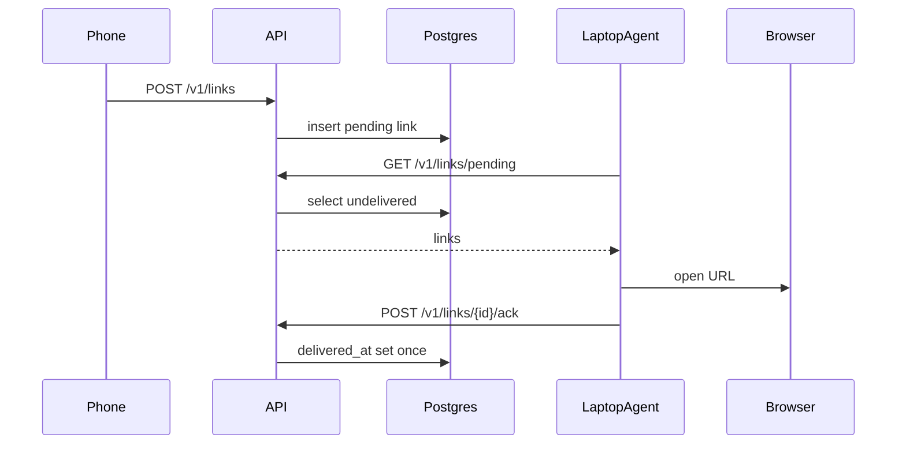

# deskdrop v2: feasibility and build plan

**Do not write product code until this plan is agreed.** Work stays on [`v2`](https://github.com/shashankxrm/deskdrop) (already an empty reset at `8971fcd`). Treat [`main`](https://github.com/shashankxrm/deskdrop) as a retrospective source only; do not port Express/Socket.IO/Mongo/Redis/Electron/WebAuthn.

**Hard ship date: 1 January 2027.** By then, all of this must be live: public HTTPS, Android + macOS end to end, CI/CD (test, build, push GHCR, deploy), Terraform + k3s on Oracle (Ampere from A0), Grafana showing real numbers from the live service.

Today is 10 Oct 2026. That fits **if local Compose E2E works before the first public deploy**, and if k3s is a migrate of an already-live Compose stack (not a greenfield cluster scramble in December).

**Scope lock:** do not add anything to v2 without explicit approval. If an improvement appears while building, append it to **Post-v2** with a one-line reason and an hours estimate, then keep going.

**Interview notes:** `~/deskdrop-notes/` only. Not in this repo, not in `.gitignore`. Never commit them.

---

## Docs rule (every step)

A step is not green until (1) the code/behavior acceptance checks pass **and** (2) the named doc(s) exist, match what was built, and — for every [`docs/components/*.md`](docs/components) file — end with **exact commands** to verify or demo it.

- **A0 / D3:** [`docs/components/terraform.md`](docs/components/terraform.md) (A0 records the account result; D3 adds apply commands for that shape).
- **B1 onward:** [`docs/components/testing.md`](docs/components/testing.md) (how to run every suite; grows each B/C step).
- **B1b / D1 / D2:** [`docs/components/ci-cd.md`](docs/components/ci-cd.md) (grows from Go test/vet → clients + E2E → GHCR → deploy).
- **B2–B6:** [`docs/components/pairing.md`](docs/components/pairing.md), [`docs/components/auth.md`](docs/components/auth.md), [`docs/components/delivery.md`](docs/components/delivery.md), [`docs/components/rate-limiter.md`](docs/components/rate-limiter.md), plus an ADR in [`docs/adr/`](docs/adr/) for each real decision.
- **C1–C4:** [`docs/components/android.md`](docs/components/android.md), [`docs/components/agent.md`](docs/components/agent.md), [`docs/components/dashboard.md`](docs/components/dashboard.md).
- **D0–D6:** [`docs/components/ci-cd.md`](docs/components/ci-cd.md), [`docs/components/terraform.md`](docs/components/terraform.md), [`docs/components/k3s.md`](docs/components/k3s.md), [`docs/components/backups.md`](docs/components/backups.md), Grafana notes (in architecture + verify commands), and [`docs/runbooks/`](docs/runbooks/) as each lands.
- Update [`docs/architecture.md`](docs/architecture.md) and [`docs/follow-one-link.md`](docs/follow-one-link.md) whenever a new component joins the flow.
- Write [`docs/scaling.md`](docs/scaling.md) at **D0** (first public deploy).
- **Docs polish** (README styling, final readthrough) is **Post-v2 only**. Missing docs are a failed step, not polish.

---

## Feasibility vs limits (flags)

**Fits as specified**

- Stack (Go net/http + pgx, Next.js, Kotlin share target, Go tray, pull+ack, no Redis/queues) is the right fix for v1.
- Closed-beta APK + unsigned macOS agent, DuckDNS + Caddy/Let’s Encrypt, GHCR, GitHub Actions, self-hosted Postgres, Grafana Cloud free tier: all ₹0.
- HMAC-SHA256 device tokens, per-IP pairing-claim limit, slog + `/metrics`, one Grafana dashboard: in-scope for v2.
- v1 failure modes are addressable (one pairing chain, ack-before-delete, poll-on-wake, no default secrets, start-at-login).

**Fits with a constraint (do not ignore)**

- **A0 decides k3s.** Ampere A1 (up to 4 OCPU / 24GB) can run k3s + Postgres + 2 API replicas + dashboard + cert-manager. A 1GB micro **cannot**. D3 only Terraform-ifies whatever A0 got. D4 (Compose → k3s) runs **only** if A0 recorded Ampere. If A0 is micro or refused, **promote k3d-in-CI from Post-v2 into D1** and keep production on Compose; do not fake k3s-on-1GB. That would miss the “k3s on Oracle by Jan 1” line — treat it as a recorded miss in terraform.md, not a silent skip.
- **macOS unsigned binaries** hit Gatekeeper. README must document “Open Anyway”. Notarization is paid.
- **In-memory token bucket + 2 API replicas** after D4: per-pod limits. Postgres-backed global limiter is Post-v2. Claim-per-IP in B2 is still per-pod until then.
- **Dashboard sign-in** uses bootstrap pairing (below). Same-origin (`/` dashboard, `/v1` API) behind Caddy, then Ingress.
- **Staging** does not fit. Local Compose + production only.
- **DuckDNS** is the hostname. Do not buy a domain.

**Does not fit in v2 — moved or replaced**

- OpenTelemetry tracing, formal SLO + alert, k6, staged postmortem, Windows agent, Postgres-backed rate limiter, docs polish → **Post-v2**.
- Linux agent, iOS, E2E encryption, sharing text/files → **Post-v2**.
- k3d-in-CI → **Post-v2 unless A0 is not Ampere** (then it becomes v2 in D1).

**Oracle fallback (A0 writes the outcome; D0/D3/D4 follow it):**

1. Always Free **Ampere A1** (Phoenix/San Jose often have capacity) → D0 Compose on that VM, D4 migrate to k3s, Grafana Cloud or in-cluster.
2. Micro only → D0 Compose+Caddy on the micro (tight RAM: API+Postgres+Caddy+dashboard only); D4 skipped; k3d-in-CI promoted; Grafana Cloud (not in-cluster).
3. Account refused → next ₹0 host (GCP e2-micro, then home lab + DuckDNS, disclose it). D3 Terraform targets that host. k3s-on-Oracle is a miss. Do not pay.

---

## Architecture decisions locked for the plan

**Bootstrap pairing**

- A user *is* the set of devices that paired through the same chain. No email, password, or WebAuthn.
- **First device:** unauthenticated `POST /v1/pairings` creates a `users` row + a single-use pairing code (TTL ~2–5 min). Claim returns a device token once.
- **Token at rest:** `HMAC-SHA256(pepper, token)` (Go `hmac` + `sha256`, key = `DEVICE_TOKEN_PEPPER`). Not `sha256(pepper || token)`.
- **Later devices:** only an already-paired device (or dashboard session) can mint a new pairing code.
- Dashboard is device type `web`. Cookie httpOnly on the site origin. User id always from token/cookie, never JSON.
- **Pairing claims** are rate-limited per IP: the 6th **wrong** claim from one IP within a minute returns 429.

**Delivery**

- Share → one `links` row, unique `(user_id, idempotency_key)`.
- Fan-out: one `link_deliveries` row per `laptop` device until ack.
- Agent: start + wake + poll; open default browser; idempotent ack.
- Never delete on pull. Purge delivered after 30 days.

**Rate limit (v2):** per-IP failed pairing claims (B2) plus per-pod token bucket on pairing create + share (B6).

**Observability (v2):** `slog` JSON + request ID. Prometheus `/metrics`: `deskdrop_shares_total`, `deskdrop_pulls_total`, `deskdrop_acks_total`, `deskdrop_pairings_total`, request latency histogram. **Grafana (v2):** one dashboard — Grafana Cloud free scraping `/metrics`, or in-cluster if Ampere — panels for shares, acks, ack rate, latency, fed from the **live** service. Must be up by 1 Jan 2027 (land it at D0, keep it through the D4 migrate). No OTEL, no SLO alert manager.

**Laptop agent (v2):** macOS Go tray, LaunchAgent. Windows is Post-v2.

**Layout (new on `v2`)**

- [`cmd/api`](cmd/api), [`cmd/agent`](cmd/agent), [`internal/`](internal/), [`migrations/`](migrations/)
- [`dashboard/`](dashboard/) Next.js
- [`android/`](android/) Kotlin
- [`deploy/compose`](deploy/compose), [`deploy/k8s`](deploy/k8s)
- [`infra/`](infra/) Terraform
- [`docs/`](docs/), [`docs/adr/`](docs/adr/), [`docs/components/testing.md`](docs/components/testing.md)
- [`tests/`](tests/) (schema SQL, compose E2E)
- [`.github/workflows`](.github/workflows)

Private notes: `~/deskdrop-notes/` on the laptop, never this tree.

---

## Testing

Locked for v2. Every **B** and **C** step adds tests for the behavior it introduces; a step is not green until those tests pass. CI (B1b, then D1) runs all of them.

**Go (API + agent)**

- Standard library `testing` only. **No testify.**
- Table-driven tests for validation, status codes, and idempotency.
- `net/http/httptest` for handlers.
- **Postgres: testcontainers-go**, real migrations, real SQL. **No mocks for the DB** (no fake `Store` interface in tests, no sqlmock).
- GitHub Actions must have Docker so testcontainers can start Postgres.

**Dashboard**

- Vitest + React Testing Library for components and pairing/device UI logic.
- One Playwright smoke in **C4**: pair + device list against local Compose.

**Android**

- JUnit unit tests for **URL validation** and **backoff** logic (no emulator required in CI).

**E2E**

- A script (Go `_test.go` or shell) against **docker compose**: pair a phone device and a laptop device, share, pull, ack, assert **single delivery**.
- Add at **B7** (HTTP clients against compose API). Extend in **C3** (drive the agent binary, not only curl). Run it in CI from **D1**.

**Docs:** [`docs/components/testing.md`](docs/components/testing.md) lists the exact command for each suite (`go test ./...`, schema SQL, Vitest, Playwright, Gradle, compose E2E). Start the file in B1; every later B/C step appends its command.

A2’s [`tests/schema/fk_delete.sql`](tests/schema/fk_delete.sql) stays as the schema FK check (psql against compose). From B2, the same FK/delete behavior is also covered by testcontainers tests — still no DB mocks.

---

## Build steps

Work in order. A step is not started until the previous acceptance check is green.

### Phase A — week 1

**A0. Oracle signup**
- Create the OCI Always Free account. Try to claim an Ampere A1 instance now (do not wait for D3).
- Record the outcome as exactly one of: `Ampere` / `micro only` / `refused` (plus region, shape, OCID if any).
- **Accept:** you can log into the OCI console; terraform.md states the outcome in the first paragraph.
- **Docs:** [`docs/components/terraform.md`](docs/components/terraform.md) (result + what D3/D4 will do with it). If the repo does not exist yet, A1 commits this file the same week — A0 is not green until that file is on `v2`.

**A1. Repo contract and v1 retrospective**
- `.gitignore`: binaries, `.env`, Terraform state. **Do not** mention interview notes or `.interview-notes/`.
- `LICENSE`, v2 doc stubs, `.env.example` with **no default secrets**.
- [`docs/v1-retrospective.md`](docs/v1-retrospective.md); README problem statement.
- **Accept:** clone on a clean machine; retrospective maps every v1 cause to a v2 control; `rg "dev-token|dev-secret|CORS \*|interview-notes"` is empty.
- **Docs:** [`docs/v1-retrospective.md`](docs/v1-retrospective.md), [`README.md`](README.md), stub [`docs/architecture.md`](docs/architecture.md); commit A0’s [`docs/components/terraform.md`](docs/components/terraform.md) if not already on the branch.

**A2. Compose + Postgres + migration runner**
- Local `docker compose`: Postgres 16, API placeholder healthz, golang-migrate.
- Migration 001: `users`, `devices`, `pairing_codes`, `links`, `link_deliveries` + indexes.
- **Accept:** `docker compose up`; `psql` shows tables; migrate up/down twice; [`tests/schema/fk_delete.sql`](tests/schema/fk_delete.sql) passes (device delete keeps the link; user delete leaves zero rows).
- **Docs:** [`docs/components/database-schema.md`](docs/components/database-schema.md); ADR Postgres-as-queue; update [`docs/architecture.md`](docs/architecture.md).

### Phase B — API (weeks 1–3)

**B1. HTTP server skeleton + slog + request IDs + latency histogram**
- `net/http`, `slog` JSON, request ID middleware, timeouts, graceful shutdown, `/healthz` `/readyz`, `/metrics` latency histogram (counters as endpoints land).
- Missing `DEVICE_TOKEN_PEPPER` → process exits. No hardcoded fallbacks.
- **Accept:** `go test` with `httptest` for `/healthz` (and `/readyz` once Postgres is pinged); missing env → non-zero exit (table-driven); compose `readyz` 200; log line has `request_id`; `curl /metrics` shows the histogram. No testify.
- **Docs:** [`docs/components/api.md`](docs/components/api.md); start [`docs/components/testing.md`](docs/components/testing.md) (`go test ./...`); update [`docs/architecture.md`](docs/architecture.md).

**B1b. Basic CI**
- GitHub Actions on every push/PR to `v2`: Go `vet` + `go test ./...` with **Docker** (testcontainers). No testify in CI either.
- **Accept:** a PR that fails `go test` is red; a passing PR is green; the job can start a Postgres container.
- **Docs:** start [`docs/components/ci-cd.md`](docs/components/ci-cd.md) (workflow file, required check). D1 will extend this file. Update [`docs/components/testing.md`](docs/components/testing.md) with the CI job name.

**B2. Pairing**
- Bootstrap vs authenticated create; single-use TTL code; claim returns token once; store `HMAC-SHA256(pepper, token)`.
- Rate-limit pairing **claims** per IP: 6th wrong claim from one IP in a minute → 429.
- Increment `deskdrop_pairings_total`.
- **Accept:** table-driven handler tests via `httptest` plus **testcontainers Postgres** (not mocks): double claim → 409; expired → 410; DB has no plaintext token; two bootstraps → two `user_id`s; 6th wrong claim from one IP in a minute → 429; `/metrics` pairing counter increments.
- **Docs:** [`docs/components/pairing.md`](docs/components/pairing.md) (curl create+claim + the 429 demo); ADR HMAC tokens + bootstrap; update [`docs/architecture.md`](docs/architecture.md), [`docs/follow-one-link.md`](docs/follow-one-link.md), [`docs/components/testing.md`](docs/components/testing.md).

**B3. Auth middleware + device CRUD**
- Bearer and cookie. List/rename/revoke. Revoke → immediate 401. No `userId` from JSON.
- **Accept:** `httptest` + testcontainers: body `userId` ignored; revoked token cannot share or pull; cookie vs bearer as implemented.
- **Docs:** [`docs/components/auth.md`](docs/components/auth.md); ADR cookie vs bearer; update [`docs/architecture.md`](docs/architecture.md) and [`docs/components/testing.md`](docs/components/testing.md).

**B4. Share + pending pull + ack**
- `http`/`https` only, payload cap, `Idempotency-Key` required.
- Pull only this laptop’s pending deliveries. Idempotent ack. Duplicate idempotency key does not insert a second link.
- Counters: shares, pulls, acks.
- **Accept:** table-driven `httptest` + testcontainers (no DB mocks): bad URL, huge body, replayed key, double ack, phone cannot pull; `/metrics` shows the three counters.
- **Docs:** [`docs/components/delivery.md`](docs/components/delivery.md); ADR at-least-once + idempotent ack; update [`docs/architecture.md`](docs/architecture.md), [`docs/follow-one-link.md`](docs/follow-one-link.md), [`docs/components/testing.md`](docs/components/testing.md).

**B5. History, account delete, retention job**
- Cursor pagination. `DELETE /v1/account`. Purge delivered > 30 days.
- **Accept:** testcontainers: stable pagination; account delete leaves zero rows; retention test with a stamped old row (same story as A2’s SQL FK test, now through the API).
- **Docs:** update [`docs/components/delivery.md`](docs/components/delivery.md) and [`docs/components/auth.md`](docs/components/auth.md); ADR pagination/TTL; update [`docs/follow-one-link.md`](docs/follow-one-link.md) cleanup hop and [`docs/components/testing.md`](docs/components/testing.md).

**B6. CORS + in-process rate limit + security headers**
- CORS allowlist from env. Per-pod token bucket on pairing **create** and share (`hey`, not k6). Claim-per-IP already in B2.
- **Accept:** `httptest` table-driven: disallowed origin has no ACAO; rapid pairing creates from one IP get 429; plus `hey` demo command in the doc.
- **Docs:** [`docs/components/rate-limiter.md`](docs/components/rate-limiter.md) (`hey` 429 command + the B2 claim-429 command); ADR per-pod vs global; update [`docs/architecture.md`](docs/architecture.md) and [`docs/components/testing.md`](docs/components/testing.md).

**B7. Follow-one-link + what-breaks (API-only pass) + compose E2E**
- Fill [`docs/follow-one-link.md`](docs/follow-one-link.md) and [`docs/what-breaks-if.md`](docs/what-breaks-if.md) (handlers, tables, `request_id`, metric names). Clients added in Phase C.
- ADR: pull vs push.
- Add the **compose E2E** script: pair phone + laptop (HTTP), share, pull, ack, assert a **single** delivery (second pull empty; double ack still one row).
- **Accept:** curl-only trace of a share; E2E script green against `docker compose`; docs mention sleep-mid-ack, duplicate share, API restart.
- **Docs:** follow-one-link, what-breaks-if, testing.md (E2E command).

### Phase C — clients (weeks 3–7)

**C1. Android pairing screen**
- Paste + QR; EncryptedSharedPreferences; no compiled-in token; jittered backoff.
- **Accept:** APK pairs to local compose on LAN; token absent from apk strings; **JUnit** tests for jittered backoff pass (`./gradlew test`).
- **Docs:** [`docs/components/android.md`](docs/components/android.md); update [`docs/architecture.md`](docs/architecture.md), [`docs/follow-one-link.md`](docs/follow-one-link.md), [`docs/components/testing.md`](docs/components/testing.md).

**C2. Android share target**
- `ACTION_SEND` URL + optional title; `Idempotency-Key` per tap.
- **Accept:** YouTube share → 201; retried intent does not duplicate; non-URL rejected in-app; **JUnit** table-driven URL validation tests pass.
- **Docs:** update [`docs/components/android.md`](docs/components/android.md), [`docs/follow-one-link.md`](docs/follow-one-link.md), [`docs/components/testing.md`](docs/components/testing.md).

**C3. macOS agent**
- Pair, tray, recent links, 10s poll, default browser, ack, LaunchAgent, config dir 0600. Poll is the sleep/wake guarantee.
- **Accept:** sleep 2+ minutes with a pending share → one browser open on wake; relaunch does not reopen acked links; login item starts the agent; **Go tests** for poll/ack/idempotency (`httptest`, stdlib); **E2E extended** to run the agent binary against compose and still assert single delivery.
- **Docs:** [`docs/components/agent.md`](docs/components/agent.md) (build, Gatekeeper, sleep/wake); update [`docs/architecture.md`](docs/architecture.md), [`docs/follow-one-link.md`](docs/follow-one-link.md), [`docs/components/testing.md`](docs/components/testing.md).

**C4. Next.js dashboard**
- Web device QR, devices, history, delete account, privacy page.
- **Accept:** bootstrap or second-device pair; unpair agent → 401 in tray; delete account wipes API data; **Vitest + RTL** for pairing/device list; **one Playwright smoke** (pair + device list) against local Compose.
- **Docs:** [`docs/components/dashboard.md`](docs/components/dashboard.md); privacy policy; update [`docs/architecture.md`](docs/architecture.md), [`docs/follow-one-link.md`](docs/follow-one-link.md), [`docs/components/testing.md`](docs/components/testing.md).

### Phase D — platform (after C4; weeks 7–11)

**D0. First public deploy (closed beta starts here)**
- Deploy **API + Postgres + dashboard** on the Oracle VM from A0 with **Docker Compose + Caddy** (automatic TLS, DuckDNS). Same origin: `/` dashboard, `/v1` API, `/metrics` (scrape-restricted).
- GitHub **Releases + checksums** for the Android APK and macOS agent.
- Grafana: Cloud free tier scraping live `/metrics` (or in-cluster if A0 is Ampere **and** RAM allows). One dashboard: shares, acks, ack rate, latency.
- You use it yourself, then friends. This **is** the closed beta — not Phase E.
- **Accept:** `curl https://<duckdns>/healthz` is 200; you share a link from Android and the Mac agent opens it; Grafana shows that share/ack; Release assets verify against checksums.
- **Docs:** [`docs/scaling.md`](docs/scaling.md); Compose+Caddy runbook; update [`docs/architecture.md`](docs/architecture.md), [`docs/follow-one-link.md`](docs/follow-one-link.md), [`docs/components/ci-cd.md`](docs/components/ci-cd.md) (release+checksum commands), [`docs/components/terraform.md`](docs/components/terraform.md) (what is actually running on the VM), Grafana verify commands (panels + scrape URL).

**D1. CI clients + deploy hook**
- Extend the B1b workflow: `go test ./...` (testcontainers), Next lint/build, **Vitest**, **Playwright smoke**, **Gradle test**, macOS/linux agent compile, and the **compose E2E** script. **Do not** deploy from forks. No Windows `.exe` in v2.
- If A0 was **not** Ampere: add **k3d-in-CI** here (promoted from Post-v2).
- Add deploy-on-merge to the live Compose stack (SSH/compose pull) so CI/CD includes deploy before D4.
- **Accept:** failing Go, Vitest, Playwright, Gradle, or E2E tests red the PR; merge to `v2` deploys; (if promoted) k3d job applies manifests in CI.
- **Docs:** update [`docs/components/ci-cd.md`](docs/components/ci-cd.md) and [`docs/components/testing.md`](docs/components/testing.md) (what CI runs).

**D2. Container images**
- Multi-stage distroless/non-root API (+ dashboard) images; push to GHCR on merge to `v2`.
- **Accept:** non-root `docker run`; image has no `.env`/tokens; public GHCR pull; CI pushes on merge.
- **Docs:** update [`docs/components/ci-cd.md`](docs/components/ci-cd.md) (build/push).

**D3. Terraform codifies A0**
- Terraform manages the VM **you already have** (import if created in console): VCN, NSG 80/443/22, the A0 shape, DuckDNS, OCI Object Storage for **state and backups**. Do not “try a different shape” here.
- **Accept:** `terraform plan` matches reality (no surprise destroy of the live VM); state not in git.
- **Docs:** [`docs/components/terraform.md`](docs/components/terraform.md) (`init`/`plan`/`apply`/`import` commands for the recorded shape).

**D4. Migrate live Compose → k3s**
- **Only if A0 is Ampere.** Move the live service from Compose+Caddy to single-node k3s (cert-manager + Let’s Encrypt, manifests, 2 API replicas, probes, NetworkPolicy: only API → Postgres). **No data loss, minimal downtime** (dump/restore or attach the same volume; cut DNS/Caddy last).
- CI deploy target switches from compose to `kubectl apply`.
- Grafana keeps working (scrape the new `/metrics` URL).
- If A0 is not Ampere: skip; state why in k3s.md; production stays Compose.
- **Accept (Ampere):** users table row count unchanged across the cut; a share during/after cut still delivers; `kubectl -n deskdrop get pods` Ready; cert READY; kill one API pod, shares still work; Postgres not on a public NodePort.
- **Docs:** [`docs/components/k3s.md`](docs/components/k3s.md) (install, apply, cutover commands); **ADR** Compose→k3s migrate; runbook; update [`docs/architecture.md`](docs/architecture.md) and [`docs/scaling.md`](docs/scaling.md).

**D5. Secrets and no-default-secrets audit**
- Secrets via env / K8s Secrets, never committed. CI grep for v1 defaults.
- **Accept:** `rg` for `dev-token`, `change-in-production`, `cors.AllowAll`, `nodeIntegration` empty; deploy without secrets does not start.
- **Docs:** secret-injection runbook; [`docs/what-breaks-if.md`](docs/what-breaks-if.md) token-leak case.

**D6. Backups**
- Nightly `pg_dump` to Object Storage; restore drill.
- **Accept:** one successful restore; timestamp in the runbook.
- **Docs:** [`docs/components/backups.md`](docs/components/backups.md), [`docs/runbooks/restore-postgres.md`](docs/runbooks/restore-postgres.md).

### Phase E — ship (before 1 Jan 2027)

**E1. Beta numbers**
- Collect and publish numbers from the beta **already running since D0**: users, links delivered, success rate (acks vs shares), latency (Grafana / `/metrics` histogram). No formal SLO.
- **Accept:** README “Key numbers” are from prod, not fixtures; privacy policy linked from dashboard and Android.
- **Docs:** [`README.md`](README.md) numbers only (not styling polish).

**E2. Recruiter README + default branch**
- Mermaid architecture, one-line stack, live HTTPS link, APK+agent install (Gatekeeper + checksums), links into `docs/`. Grafana screenshots optional; the live dashboard is the source of truth.
- Make `v2` the GitHub default **by 1 January 2027**.
- **Accept:** a stranger can pair and deliver one link from the README; 2-minute talk from [`docs/follow-one-link.md`](docs/follow-one-link.md).
- **Docs:** [`README.md`](README.md) content complete (visual polish is Post-v2).

---

## v1 → v2 control map (must stay true)

- Hardcoded Android `DEV_TOKEN` vs WebAuthn laptop user → one pairing chain, HMAC-SHA256 device tokens.
- `WEBAUTHN_RP_ID` vs `RP_ID` → no WebAuthn; env names match `os.Getenv`; boot fails on missing required env.
- Sleeping host + Socket.IO → pull+ack; links survive API restart and the D4 migrate.
- No start-at-login → macOS LaunchAgent, tested.
- Delete queue without ack → `acked_at` required; purge only delivered ∩ 30 days.
- Default secrets, `userId` in body, CORS `*`, Electron `nodeIntegration` → forbidden; CI grep.

---

## Post-v2

Not in the 1 Jan critical path. Do not start these during v2 unless you explicitly approve a promotion. While building v2, **append** new ideas here (reason + hours) and keep going.

**Moved out of v2**

- **OpenTelemetry tracing** (~8h) — request IDs + `/metrics` + Grafana cover v2.
- **Formal SLO + alert** (~6h) — add after weeks of real Grafana data.
- **k6 load test + README p95** (~4h) — replace `hey` with a dated k6 run.
- **Staged incident + postmortem** (~6h) — deliberate break, recover, [`docs/postmortems/`](docs/postmortems/).
- **Windows agent** (~12h + a Windows box).
- **Postgres-backed rate limiter** (~5h).
- **Docs polish** (~3h) — README styling and a final readthrough only.
- **k3d-in-CI** (~6h) — **stays here unless A0 is not Ampere**, in which case it is done in D1.

**Feature ideas**

- **Share text/files** (~20h+).
- **Linux agent** (~8h).
- **E2E encryption** (~16h).
- **iOS client** — not ₹0.
- **SSE / push** (~6h) if pull lag is a real complaint.
- **NetworkPolicy break-glass runbook expansion** (~4h).

**Append while building (template)**

- `YYYY-MM-DD: <idea> — <one-line reason>. ~Nh.`
