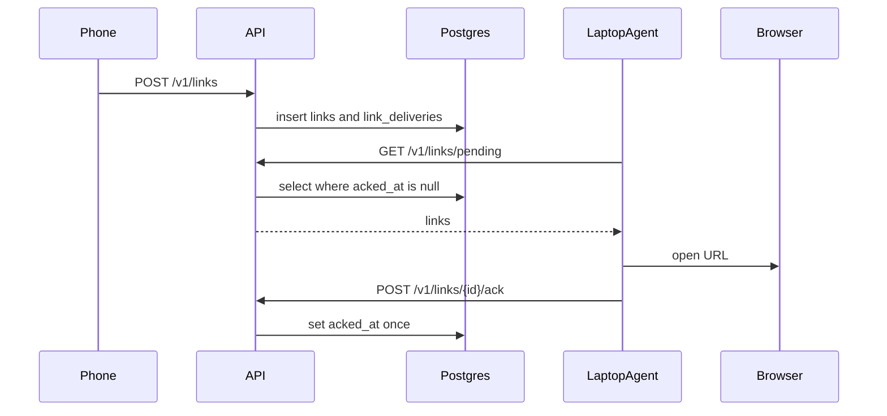

# deskdrop

Share a URL from Android; a paired Mac opens it in the default browser even if the laptop was asleep. No password. One pairing chain is one user.

**Live:** [https://shashank-dropdesk.duckdns.org](https://shashank-dropdesk.duckdns.org) · **Privacy:** [/privacy](https://shashank-dropdesk.duckdns.org/privacy) · [docs/privacy.md](docs/privacy.md)

**Stack:** Go `net/http` API, PostgreSQL 16 (the queue), Next.js dashboard, Kotlin share target, macOS Go tray — on one Always Free Oracle Ampere VM (k3s + Traefik + Let’s Encrypt).

Two-minute walkthrough: [docs/follow-one-link.md](docs/follow-one-link.md). Pairing steps: [docs/connect.md](docs/connect.md). Why v1 failed: [docs/v1-retrospective.md](docs/v1-retrospective.md).

## Key numbers

From production Postgres on **2026-10-12** (not fixtures; Prometheus counters reset when API pods restart):

| | |
|---|---|
| Pairing chains (users) | 6 |
| Devices | 13 |
| Links shared | 8 |
| Deliveries acked | 4 of 8 (50%) |
| Pending-pull p95 | ~10 ms (`GET /v1/links/pending` histogram on a live API pod) |

No formal SLO (Post-v2). Grafana Cloud scrapes `/metrics`.

## How a share travels



## Install (closed beta)

Unsigned macOS binary: System Settings → Privacy & Security → **Open Anyway** (or `xattr -d com.apple.quarantine`). Checksums: `./scripts/release-checksums.sh` then `cd dist && shasum -a 256 -c SHA256SUMS`. Publish with `gh release create` when you cut a tag.

### Mac agent

```bash
git clone -b v2 https://github.com/shashankxrm/deskdrop.git
cd deskdrop
mkdir -p ~/.local/bin
go build -o ~/.local/bin/deskdrop-agent ./cmd/agent
# 1. Browser: https://shashank-dropdesk.duckdns.org → Start a new pairing
# 2. Phone: Scan QR, Pair as phone
# 3. Same code on the Mac:
deskdrop-agent pair -code ABCD-EFGH
deskdrop-agent run
deskdrop-agent install   # LaunchAgent; Quit exits 0 so it does not relaunch
```

Default `-api` is production HTTPS. Gatekeeper: [docs/components/agent.md](docs/components/agent.md).

### Android

```bash
cd android
./gradlew assembleDebug
# install app/build/outputs/apk/debug/app-debug.apk
```

Production API URL is pre-filled. Scan the dashboard QR, then share a YouTube link to **deskdrop**. Details: [docs/components/android.md](docs/components/android.md).

## Features

- Pair phone, laptop, and web with a short-lived QR / pairing code. No email.
- Android `ACTION_SEND` URL (optional title); `Idempotency-Key` per tap.
- Agent: 10s poll, start at login, ack once; sleep/wake is the ticker.
- Dashboard: devices, history, delete account.
- Delivered rows purged after 30 days.

## Local development

```bash
docker compose up --build -d
cd dashboard && npm run dev
```

API `http://127.0.0.1:8080`, dashboard `http://127.0.0.1:3000`. Tests: [docs/components/testing.md](docs/components/testing.md).

## Docs

- [Connect](docs/connect.md) · [Architecture](docs/architecture.md) · [Follow one link](docs/follow-one-link.md) · [What breaks if](docs/what-breaks-if.md)
- [Pairing](docs/components/pairing.md) · [Auth](docs/components/auth.md) · [Delivery](docs/components/delivery.md) · [Rate limits](docs/components/rate-limiter.md)
- [Android](docs/components/android.md) · [Agent](docs/components/agent.md) · [Dashboard](docs/components/dashboard.md) · [Privacy](docs/privacy.md)
- [k3s](docs/components/k3s.md) · [Terraform](docs/components/terraform.md) · [CI](docs/components/ci-cd.md) · [Backups](docs/components/backups.md)
- [Grafana](docs/components/grafana.md) · [Scaling](docs/scaling.md) · [Secrets](docs/runbooks/secrets.md)
