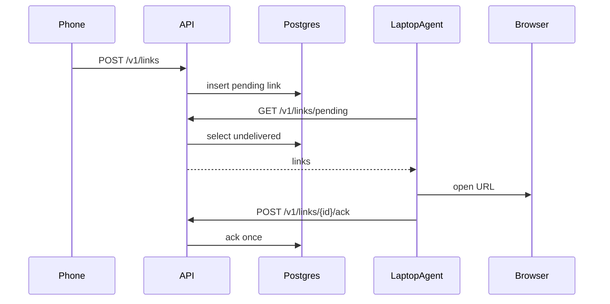

# Architecture

Stub as of A1. Update this file whenever a component joins the flow.

## What it is

deskdrop queues a URL from an Android share until a paired laptop agent pulls it, opens the default browser, and acks. One user is one pairing chain. Production target is a single Always Free Oracle VM (A0 **pending**).

## Components (planned)

| Piece | Role | Status |
|---|---|---|
| Go API | REST, pairing, share, pull, ack | not started (B1) |
| PostgreSQL | users, devices, links, deliveries | not started (A2) |
| Android client | pair + share target | not started (C1–C2) |
| macOS agent | poll, open browser, ack | not started (C3) |
| Next.js dashboard | pair, devices, history, delete account | not started (C4) |
| Oracle VM | public HTTPS later | A0 pending |

## Data flow (target)

## Verify

Nothing to run yet besides reading this file and the v1 retrospective. After A2: `docker compose up` and the commands in `docs/components/database-schema.md`.
