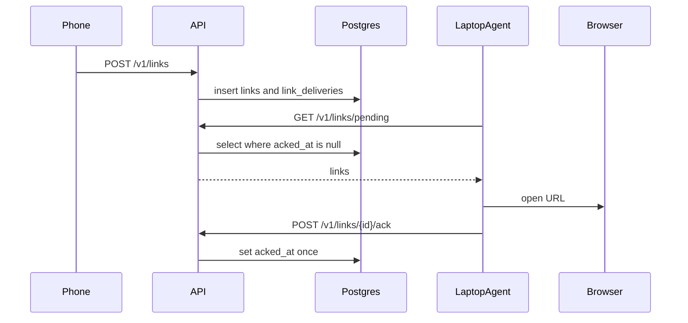

# Architecture

Updated A2. Update this file whenever a component joins the flow.

## What it is

deskdrop queues a URL from an Android share until a paired laptop agent pulls it, opens the default browser, and acks. One user is one pairing chain. Production target is a single Always Free Oracle VM (A0 **pending**).

Locally, Docker Compose runs Postgres 16, golang-migrate, and the Go API (`/healthz`, `/readyz`, `/metrics`).

## Components

| Piece | Role | Status |
|---|---|---|
| Go API | env config, slog + request IDs, `/healthz` `/readyz` `/metrics` histogram | B1 ([api.md](components/api.md)) |
| PostgreSQL | users, devices, pairing_codes, links, link_deliveries | A2 — schema in [database-schema.md](components/database-schema.md) |
| Android client | pair + share target | not started (C1–C2) |
| macOS agent | poll, open browser, ack | not started (C3) |
| Next.js dashboard | pair, devices, history, delete account | not started (C4) |
| Oracle VM | public HTTPS later | A0 pending |
| CI | `go vet` + `go test ./...` on push/PR to `v2` | B1b ([ci-cd.md](components/ci-cd.md)) |

Queue choice: [ADR 0001 — Postgres as the delivery queue](adr/0001-postgres-as-queue.md).

## Data flow (target)

## Verify

- Schema: [database-schema.md](components/database-schema.md)
- API: [api.md](components/api.md) (`go test ./...`, `curl /readyz`, `/metrics`)
- Suites: [testing.md](components/testing.md)
- CI: [ci-cd.md](components/ci-cd.md) (job `go-test`)
