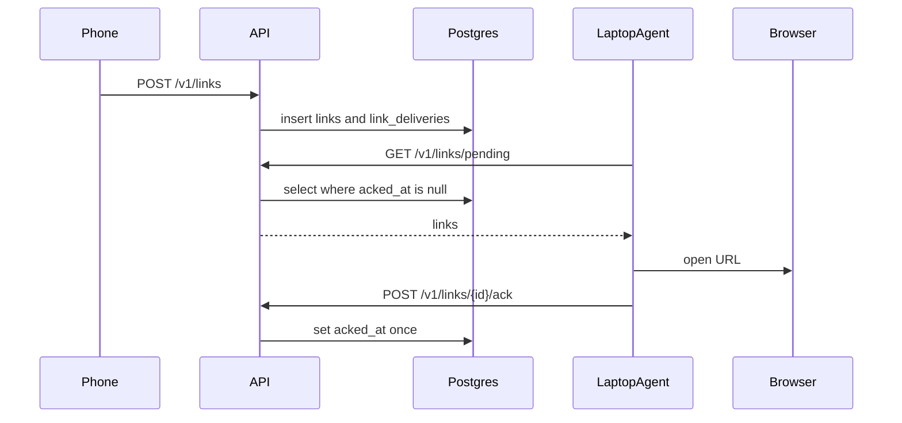

# Architecture

Updated A2. Update this file whenever a component joins the flow.

## What it is

deskdrop queues a URL from an Android share until a paired laptop agent pulls it, opens the default browser, and acks. One user is one pairing chain. Production target is a single Always Free Oracle VM (A0 **pending**).

Locally, Docker Compose runs Postgres 16, golang-migrate, and a `/healthz` API placeholder.

## Components

| Piece | Role | Status |
|---|---|---|
| Go API | REST later; `/healthz` placeholder now | A2 placeholder (B1 replaces it) |
| PostgreSQL | users, devices, pairing_codes, links, link_deliveries | A2 — schema in [database-schema.md](components/database-schema.md) |
| Android client | pair + share target | not started (C1–C2) |
| macOS agent | poll, open browser, ack | not started (C3) |
| Next.js dashboard | pair, devices, history, delete account | not started (C4) |
| Oracle VM | public HTTPS later | A0 pending |

Queue choice: [ADR 0001 — Postgres as the delivery queue](adr/0001-postgres-as-queue.md).

## Data flow (target)

## Verify

Commands live in [database-schema.md](components/database-schema.md): `docker compose up --build -d`, `curl /healthz`, `psql \dt`, migrate down/up twice.
